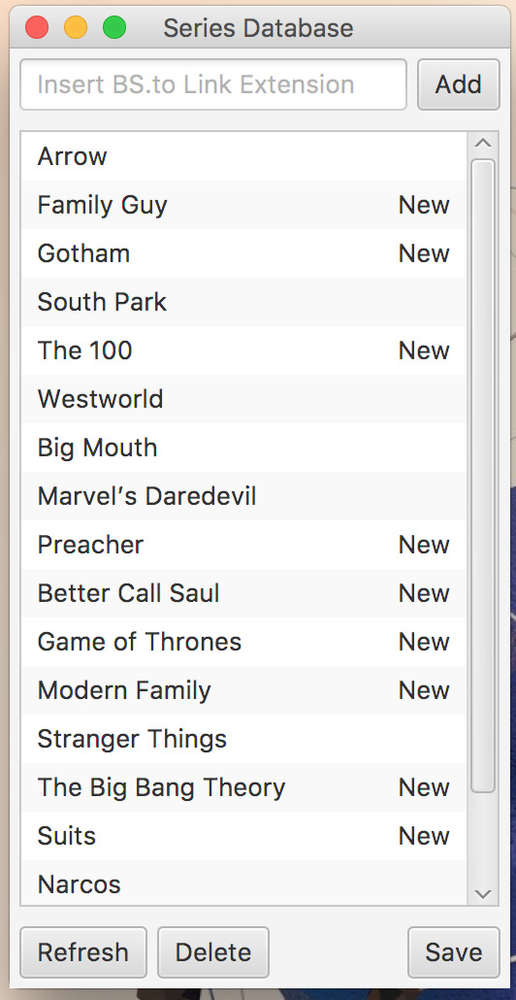
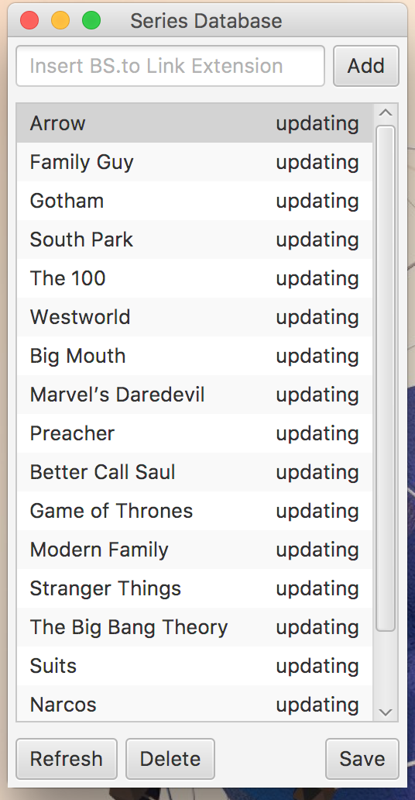
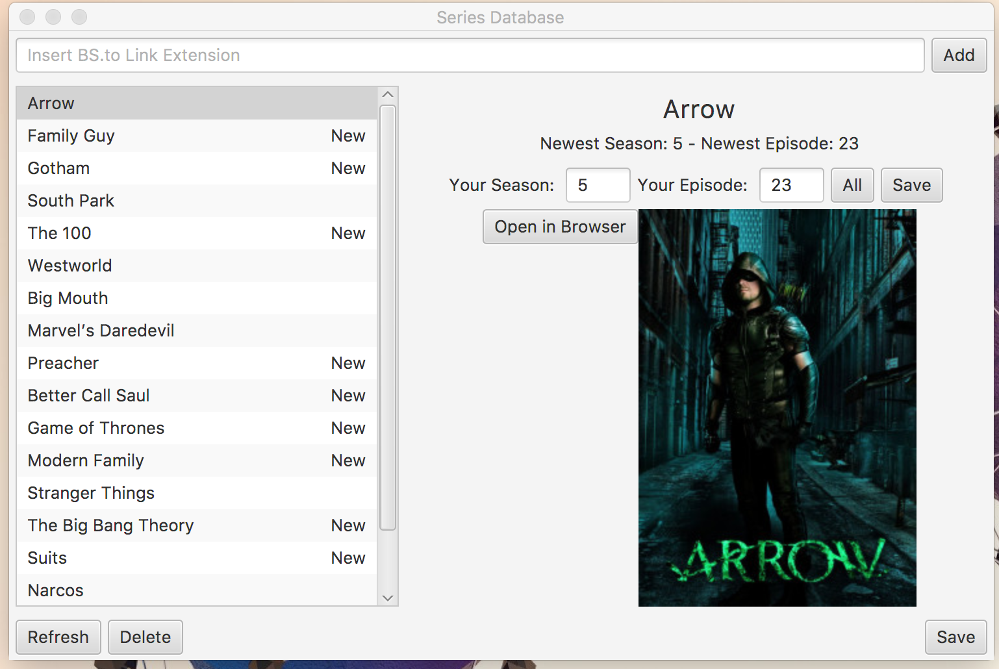
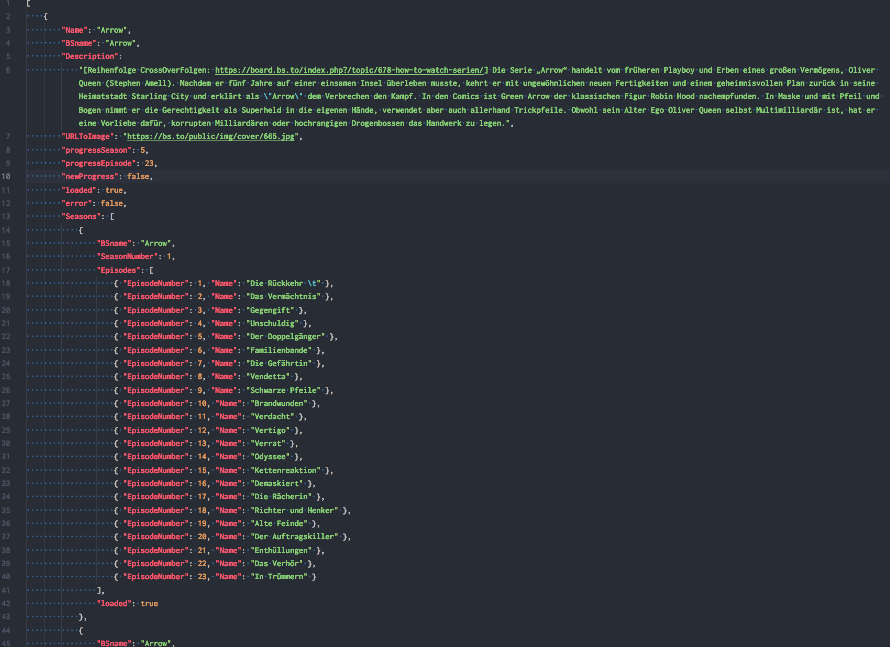

I needed to learn Java for my university, so I decided to build a small GUI application for practical experience.

The GUI of this tool is made with JavaFX. I did all the styles via [Scene-Builder](http://gluonhq.com/products/scene-builder/) because it seemed to be the easiest solution, since I am not really a good designer.

Another big extension I used is [Selenium WebDriver](https://www.seleniumhq.org/projects/webdriver/). It is really helpful for scraping the internet.

For my purposes, it's really 'ugly' if a browser pops up every time you press 'Refresh' to see if another episode of your series is out. Therefore, I decided to use a headless browser called [HTML-UnitDriver](https://github.com/SeleniumHQ/htmlunit-driver).

With its help, it was kind of easy to check for updates in the background so the user won't notice any of this work.

To store the user progress when closing the application, I used a simple JSON file database. Due to its simplicity, this fits perfectly into my little project.

## Code

[Click here](https://github.com/breuerfelix/Series-Monitor) to see the repository and code on GitHub.com!

## Screenshots

  <figure><figcaption>Home</figcaption></figure>
  <figure><figcaption>Updating</figcaption></figure>
  <figure><figcaption>Series in detail</figcaption></figure>
  <figure><figcaption>Database structure</figcaption></figure>

