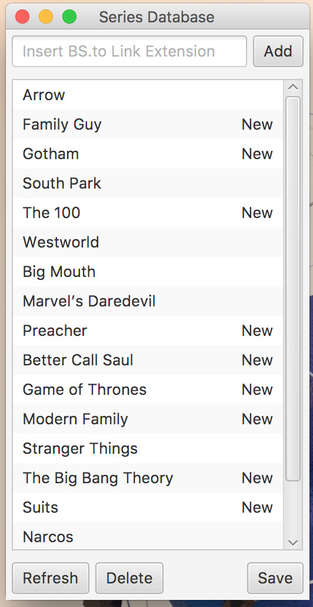
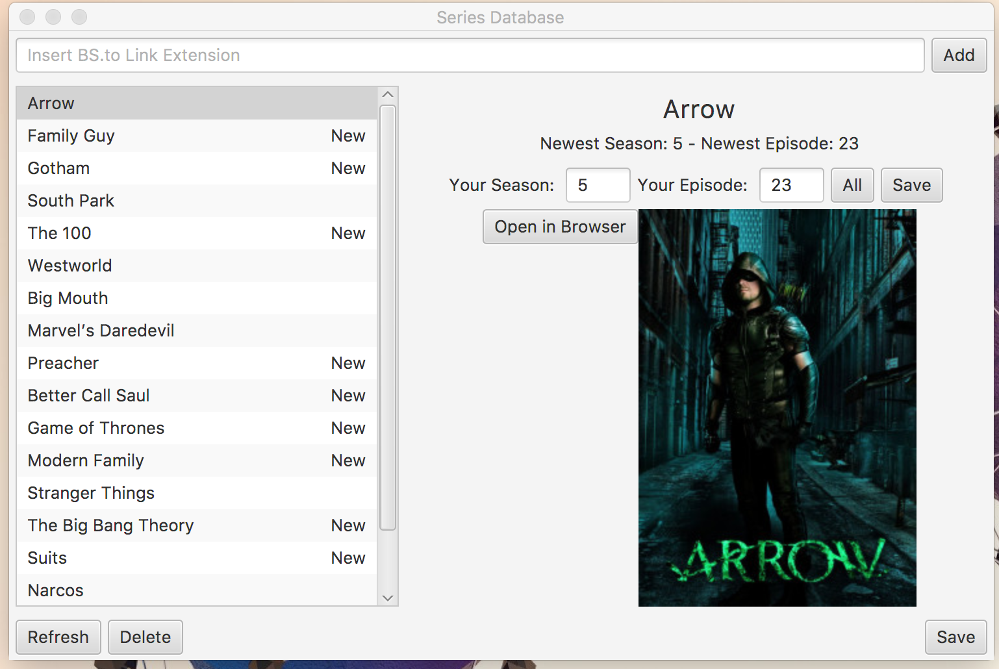

## Inline `code` and *emphasis* &amp; escaped &lt;T&gt;

<h2 id="outer-heading"><span id="inner-span">Nested inline span</span></h2>

## Footnote heading[^note]

[^note]: Note body.

Inline math: $$x^2 + y^2 = z^2$$.

$$
\frac{1}{2} + \alpha
$$

$$
\begin{equation}
E=mc^2
\end{equation}
$$

```tex
$$ x^2 $$
\begin{equation} literal \end{equation}
```



[](https://example.com/)

<script>
window.beforeComment = true;
// Valid JavaScript line comment.
window.afterComment = true;
</script>
